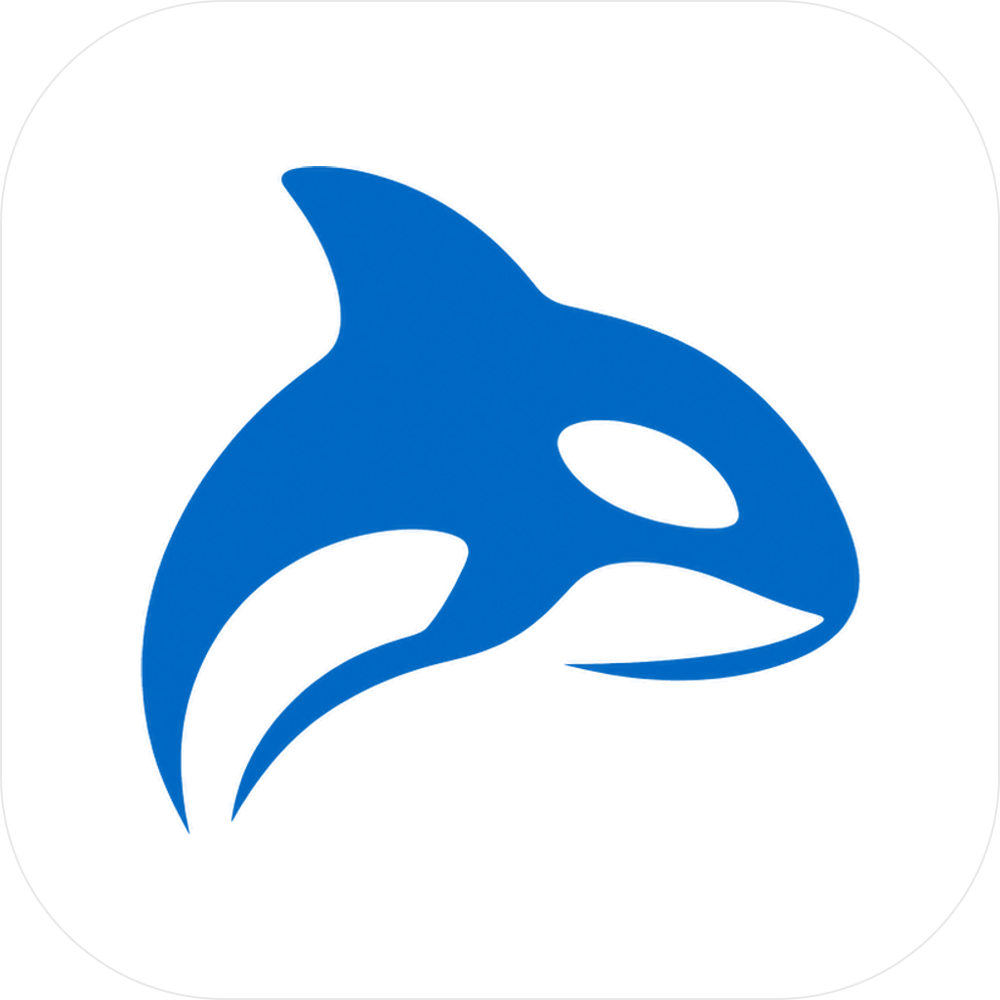
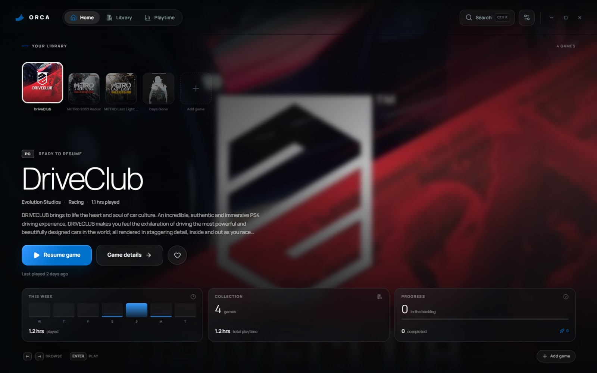
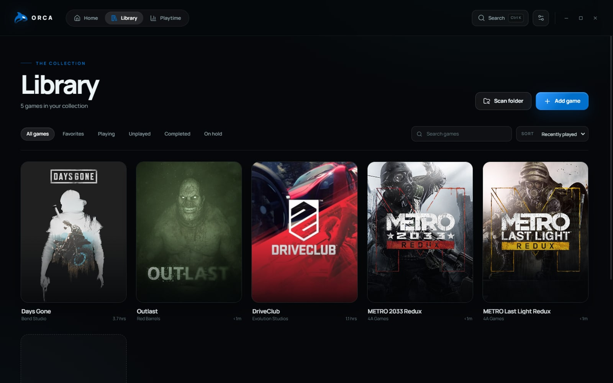
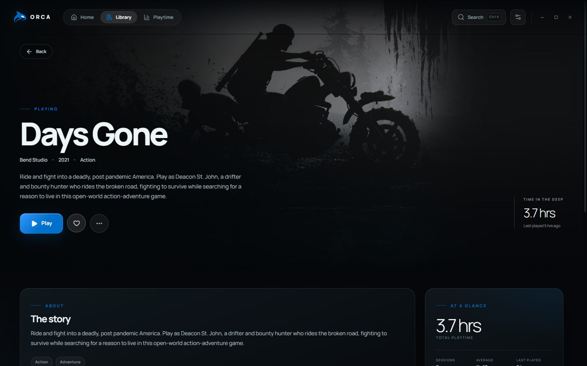
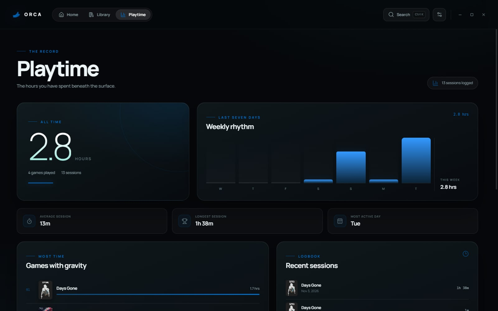
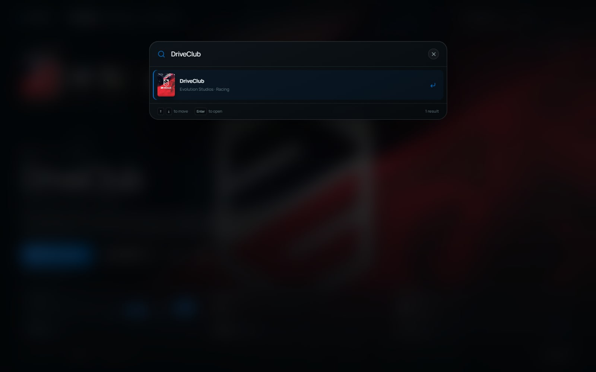

<div align="center">



# Orca

**Your games, one quiet place.**

A local-first game library, launcher, and playtime tracker for Windows.<br />
Console-inspired. No account. No telemetry.

[](https://github.com/Ragul-018/Orca/releases/latest)
[](https://github.com/Ragul-018/Orca/releases)
[](#requirements)
[](LICENSE)
[](https://www.electronjs.org/)
[](https://github.com/Ragul-018/Orca/actions/workflows/ci.yml)

**[Download](#download)** · **[Features](#features)** · **[Screens](#screens)** · **[Build from source](#build-from-source)** · **[Data & privacy](#data--privacy)**

</div>



---

## Download

|  | File | Description |
|:--|:-----|:------------|
| 🖥️ | **[Orca-1.1.0-x64.exe](https://github.com/Ragul-018/Orca/releases/latest)** | **Recommended.** Per-user installer with Start menu and desktop shortcuts. Uninstalls cleanly from Windows Settings. |
| 🎒 | **[Orca-1.1.0-portable.exe](https://github.com/Ragul-018/Orca/releases/latest)** | Single file. No installation — run it from anywhere. |

### Install

1. Download **`Orca-1.1.0-x64.exe`** from the [latest release](https://github.com/Ragul-018/Orca/releases/latest).
2. Run it, choose an install folder, and finish the wizard.
3. Open **Orca** from the Start menu or desktop shortcut.

> [!NOTE]
> The build is currently unsigned, so Windows SmartScreen may warn you. Choose **More info → Run anyway**.

### Requirements

- Windows 10 or 11, x64
- Nothing else — Node.js is **not** required for the installer

---

## Screens

| Home | Library |
|:----:|:-------:|
|  |  |
| **Game details** | **Playtime** |
|  |  |

<p align="center">
  
</p>

---

## Features

### Library

- **Automatic artwork & metadata** — search Steam with no API key and fill the title, developer, year, genres, synopsis, cover, and hero art in one click. IGDB and RAWG keys are optional extras.
- **Folder scan** — point Orca at a directory and it picks up `.exe`, `.lnk`, `.url`, `.bat`, and `.cmd` files, resolving shortcuts and extracting embedded icons.
- **Favourites, filters, ratings, and status** — spotlight what matters and keep a real backlog.
- **Manual import** — add anything with a title, executable path, and optional launch arguments.

### Play & track

- **Accurate playtime** — wall-clock sessions from launch to stop or natural exit, written to disk the moment a session ends.
- **Safe game termination** — Orca tracks the exact process IDs it launched and stops only those. It never runs a broad `taskkill /IM`.
- **External-game tracking** — optionally detect games launched from the desktop or another launcher.
- **Stats dashboard** — weekly rhythm, all-time totals, recent sessions, and per-game history.

### Interface

- **Console-style home** — full-bleed artwork, a horizontal game rail, and a focused tile that scales up as you browse.
- **Smooth browsing** — selection is compositor-only, so arrow-key moves never reflow the rail or replay the hero animation.
- **Rich sound design** — WebAudio-synthesized cues for navigation, clicks, toggles, modal open/close, success, errors, game launch, and update ready; plus the original console blip. Volume and toggle in Settings.
- **Arrange your way** — drag any tile to a new spot, or press `Alt` + `←`/`→`. The order is saved to your library.
- **Remove from home** — a trash button on the focused game opens the same confirmation as Library → More options.
- **Keyboard-first** — browse with the arrow keys, `Enter` to play, and `Ctrl+K` for fuzzy search.
- **System tray** — close to the tray and keep tracking in the background.
- **Reduce motion** — respects your system's `prefers-reduced-motion` setting for a calmer experience.

### Updates & maintenance (v1.1.0)

- **Automatic updates** — background check on launch, silent download, "Restart to install" when ready. GitHub Releases provider, no external services.
- **Window state persistence** — remembers size, position, and maximized state across sessions; validates against current display layout.
- **Backup export & restore** — full library (games, sessions, settings, artwork) as a single `.zip` or JSON fallback. Restore refuses while a game is running.
- **What's new modal** — appears once per version with a changelog summary.

---

## Build from source

### Prerequisites

| Tool | Version |
|------|---------|
| Node.js | 20 LTS or later |
| pnpm | 9 or later |

```powershell
git clone https://github.com/Ragul-018/Orca.git
cd Orca
pnpm install
pnpm dev
```

The window opens automatically. `Ctrl+Shift+I` opens DevTools.

> Orca uses [koffi](https://koffi.dev/) for native Windows process enumeration, so there is no PowerShell polling. The native binary ships prebuilt — no C++ toolchain needed.

### Commands

| Command | What it does |
|---------|--------------|
| `pnpm dev` | Dev server with hot reload |
| `pnpm build` | Type-check and compile to `out/` |
| `pnpm build:win` | Build the NSIS installer and portable `.exe` |
| `pnpm build:dir` | Build `release/win-unpacked/` only (fast) |
| `pnpm smoke` | Playwright smoke test against the built app |
| `pnpm smoke:pkg` | Smoke test against the packaged executable |
| `pnpm typecheck` | TypeScript type checking |
| `pnpm icon` | Regenerate icon set from `build/logo-source.png` |

Artifacts land in `release/`:

| File | Description |
|------|-------------|
| `Orca-1.1.0-x64.exe` | NSIS installer (per-user, optional install dir) |
| `Orca-1.1.0-portable.exe` | Single-file portable executable |
| `Orca-1.1.0-x64.exe.blockmap` | Differential update blockmap |
| `latest.yml` | Auto-update manifest for `electron-updater` |
| `win-unpacked/Orca.exe` | Unpacked build for testing |

### Adding games

1. Click **Add game** in the top bar.
2. Fill in the **Details** tab — only the title is required.
3. Open the **Artwork** tab and pick a Steam match; **Apply to game** fills every empty field.
4. Switch to **Launch setup**, choose the executable, and click **Add to Orca**.

| Type | Launched as |
|------|-------------|
| `.exe` | Direct executable |
| `.lnk` | Resolved Windows shortcut |
| `.url` | URI opened through the shell |
| `.bat` / `.cmd` | `cmd.exe /c` |

### Smoke test coverage

1. Preload API is present.
2. Empty state renders on first run.
3. Add-game modal accepts and saves every field.
4. Home, Library, Game, Search, Stats, and Settings all render.
5. Arrow-key selection never moves the neighbouring rail tiles.
6. `Alt` + arrow and drag-and-drop both persist a new home order.
7. The home trash button removes a game after confirmation.
8. Play launches the target process.
9. `koffi` process-tree tracking fires the running chip.
10. Stop confirmation closes immediately and finalises the session.
11. Playtime and sessions persist to `orca-data.json`.
12. Stats shows the recorded session.
13. No console or page errors.

Screenshots are written to `%TEMP%\orca-smoke-<dev|packaged>\`.

---

## Data & privacy

Orca is local-first by design. You do not need an account, and nothing is sent to a server except the artwork/ metadata searches you explicitly trigger.

```
%APPDATA%\orca\
  data\
    orca-data.json   # games, settings, sessions (atomic writes)
    art\             # imported covers and hero images
    window-state.json  # window bounds, position, maximized state
```

- **Atomic saves** — writes go to a temp file and are renamed, so a crash cannot leave a half-written library.
- **API keys stay local** — optional IGDB/RAWG credentials never leave your machine.
- **Uninstalling keeps your library** — data is only removed if you delete `%APPDATA%\orca\` yourself.
- **Backup & restore** — export your full library (games, sessions, settings, artwork) as a `.zip` or `.json` from Settings → Your data. Restore replaces everything in one click and refuses while a game is running.

### Custom data location

```powershell
$env:ORCA_USER_DATA = "D:\MyGames\OrcaData"
.\release\win-unpacked\Orca.exe
```

The directory is created automatically. Useful for portable libraries, isolated test runs, or data on another drive.

---

## Keyboard shortcuts

| Shortcut | Action |
|----------|--------|
| `←` `→` / `↑` `↓` | Browse the home game rail |
| `Alt` + `←` `→` | Move the focused game left or right on the home rail |
| `Enter` | Play / stop the focused game |
| `Ctrl+K` | Search your library |
| `Escape` | Close an overlay or dialog |
| `Alt+F4` | Quit Orca |

---

## Architecture

```
src/
  main/                  Electron main process (ESM)
    index.ts             Lifecycle, IPC, tray, orca-art protocol
    data-store.ts        JSON persistence, atomic writes, artwork import, zip backup/restore
    session-manager.ts   Launch, process-tree polling, safe termination
    processes-win32.ts   koffi-based process snapshots
    scanner.ts           Folder scan, .lnk/.url resolution, icon extraction
    updater.ts           electron-updater state machine (check/download/install)
    window-state.ts      Window bounds persistence (atomic, display-validated)
  preload/               CJS bridge (sandbox: true)
  renderer/              React + Vite SPA
    src/pages/           Home, Library, Game, Playtime, Settings
    src/components/      Rail, artwork, search, toasts, dialogs
    src/lib/audio.ts     WebAudio engine (synthesized cues + sample playback)
    src/styles/          Design system and layout
  shared/                Types, constants, formatters
scripts/                 Smoke test, icon build, README screenshots
.github/workflows/       CI (typecheck, lint, build, smoke) + Release
```

Artwork is served over a custom `orca-art://` protocol, so local files load without weakening the renderer CSP:

```
orca-art://art/<sha256>  ->  %APPDATA%\orca\data\art\<sha256>.{png,jpg,webp,gif}
```

### Tech stack

| Layer | Technology |
|-------|------------|
| Shell | Electron 45 |
| UI | React 19 + Vite 7 |
| Language | TypeScript 5.9 |
| State | Zustand 5 |
| Motion | Motion |
| Native APIs | koffi 3 |
| Packaging | electron-builder 26 |
| Testing | Playwright Core |
| Type | Manrope Variable |

---

## Known limitations

- **Windows only** — process enumeration uses the Win32 `TlHelp32` API.
- **No store auto-import** — Steam, Epic, GOG, and Xbox libraries are not imported automatically; use manual add or folder scan.
- **External tracking false positives** — generic executables like `cmd.exe` can match; disable the setting if that happens.
- **Unsigned builds** — SmartScreen warnings are expected until a code-signing certificate is added.

---

## Contributing

Issues and pull requests are welcome. Before opening a PR, run:

```powershell
pnpm typecheck
pnpm smoke
```

---

## License

[MIT](LICENSE) © 2026 Orca
